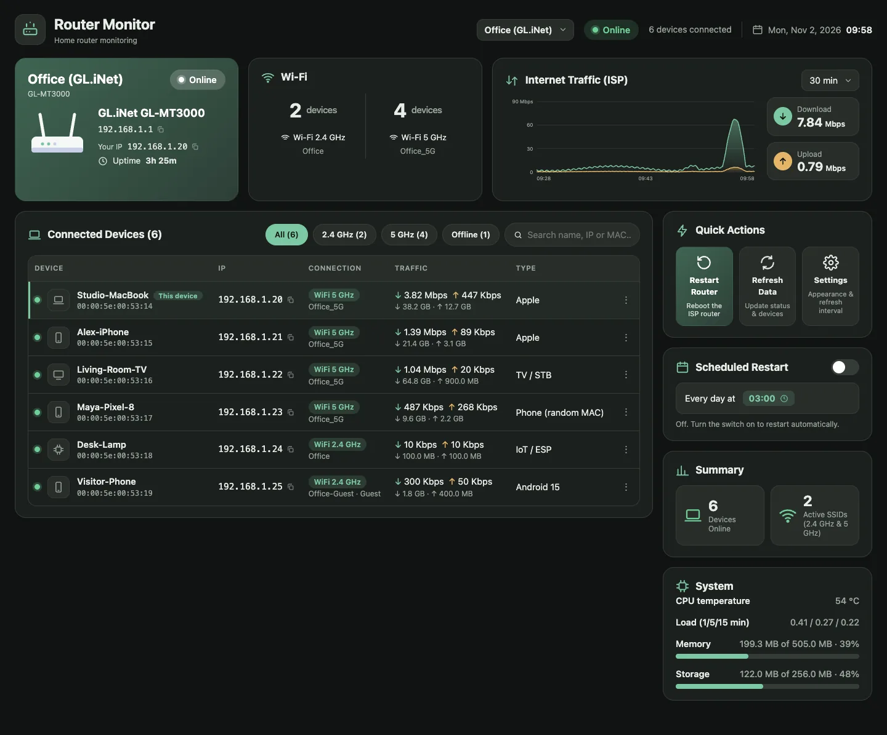
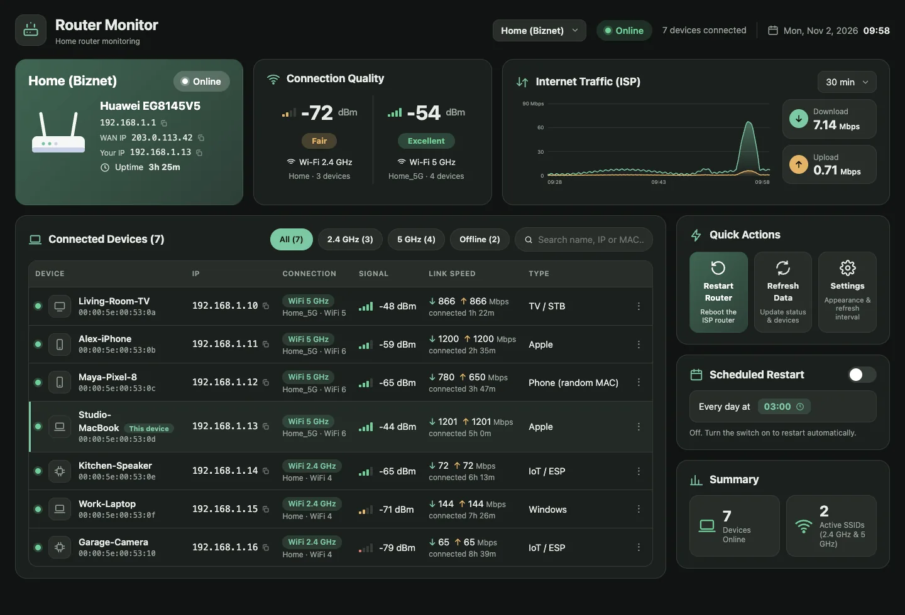
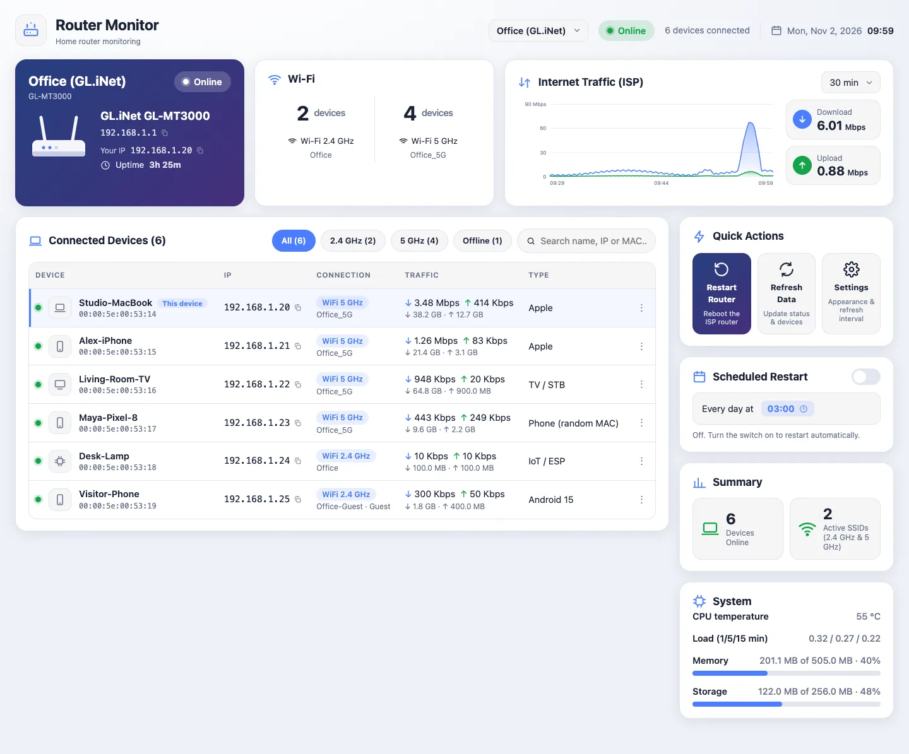

# router-monitoring

A small, fast dashboard for your home or office router. One binary, no dependencies: connected devices,
live internet traffic, router health and a scheduled restart, for several routers in one place.



- **Several routers, one page.** Save a profile per router (say a Biznet ONT at home and a GL.iNet at the office)
  and switch with the selector in the header. Each profile keeps its own history and restart schedule. When the
  router you are looking at is unreachable but another profile's router answers, the page offers to switch.
- **Instant page.** A background collector polls the router; the page only reads the collected data, so every
  tab shows the same numbers and refreshes in milliseconds.
- **Devices**: name, IP, MAC, vendor guess, band and SSID, and (when the router reports them) Wi-Fi signal,
  link rate and **traffic per device**. The device you are using is marked "This device", so you can see
  your own IP on the router. Click an IP to copy it, give devices your own names.
- **Traffic**: download/upload in Mbps for the last 5 to 60 minutes.
- **Router health**: CPU temperature, load, memory and storage (where the router exposes them).
- **Scheduled restart** per router, plus a restart button.
- **Themes and languages**: 5 dark and 6 light themes; English (default) and Bahasa Indonesia.
- **Try it without a router:** `router-monitoring -demo` runs with invented data.

| | |
|---|---|
|  |  |

## Supported routers

| Router | Devices | Wi-Fi signal | Traffic per device | WAN speed | CPU / memory | Restart |
|---|---|---|---|---|---|---|
| **Biznet / Huawei EG8145V5** ONT | yes | yes (dBm, link rate) | no | yes (~4 s, from byte counters) | not exposed | yes |
| **GL.iNet** (firmware 4.x) | yes | no | yes | yes (~2 s, reported by the router) | yes (temperature, load, memory, storage) | yes |

Developed on a Biznet EG8145V5 and a GL-MT3000 (4.9.0). Other Huawei ONTs of the HG8145 family and other
GL.iNet models should work but are untested. New routers are added as small "drivers", see
[CONTRIBUTING.md](CONTRIBUTING.md).

## Install

Download the binary for your system from the Releases page (or build it, see below) and run it:

```sh
./router-monitoring
# -> http://127.0.0.1:8787
```

Open that address. On first run a dialog asks for the router type, its address and the admin login. The login is
tested before it is saved. Add more routers later from the header selector or from Settings.

### Build from source

Needs Go 1.22+.

```sh
make build          # ./router-monitoring
make test           # vet + tests (race detector on)
make demo           # run with invented data
make dist           # binaries for macOS/Linux/Windows in dist/
```

## Options

| Flag | Default | Meaning |
|---|---|---|
| `-listen` | `127.0.0.1:8787` | HTTP address |
| `-data` | user config dir | where settings live (see below) |
| `-host` | | extra allowed host names, comma separated (e.g. `router.lan`) |
| `-lan` | off | allow other devices on your network (there is no login, trusted networks only) |
| `-demo` | off | invented data and two sample routers, nothing is saved |
| `-version` | | print version |

Data directory: `~/Library/Application Support/router-monitoring` (macOS), `~/.config/router-monitoring`
(Linux), `%AppData%\router-monitoring` (Windows).

| File | Content |
|---|---|
| `profiles.json` | your routers: address, username, password, restart schedule (mode `0600`; on Windows it relies on the per-user permissions of `%AppData%`) |
| `aliases.json` | your device names, `{"aa:bb:cc:dd:ee:ff": "Living room TV"}` (editable by hand) |
| `state-<id>.json` | last snapshot and traffic history per router, so a restart keeps the graph |
| `restart.log` | every restart (manual and scheduled) and how long the router took to come back |

## Run at login

**macOS** (`~/Library/LaunchAgents/com.example.router-monitoring.plist`, then `launchctl load` it):

```xml
<?xml version="1.0" encoding="UTF-8"?>
<!DOCTYPE plist PUBLIC "-//Apple//DTD PLIST 1.0//EN" "http://www.apple.com/DTDs/PropertyList-1.0.dtd">
<plist version="1.0"><dict>
  <key>Label</key><string>com.example.router-monitoring</string>
  <key>ProgramArguments</key><array><string>/usr/local/bin/router-monitoring</string></array>
  <key>RunAtLoad</key><true/><key>KeepAlive</key><true/>
</dict></plist>
```

**Linux** (`~/.config/systemd/user/router-monitoring.service`, then `systemctl --user enable --now router-monitoring`):

```ini
[Unit]
Description=Router monitoring
[Service]
ExecStart=%h/.local/bin/router-monitoring
Restart=always
[Install]
WantedBy=default.target
```

**pm2**: `pm2 start ./router-monitoring --interpreter none --name router-monitoring -- -listen 127.0.0.1:8787 && pm2 save`

Linux and Windows builds pass the test suite on real machines, but the autostart snippets above are only
verified on macOS.

## Scheduled restart

Each router has its own schedule: turn on the switch in the "Scheduled Restart" card and choose a time. The app
restarts that router once a day at that time, whichever router the page is showing. If the computer was asleep at
that moment, the restart still runs when it wakes up within 30 minutes of the scheduled time; later than that it is
skipped, so a router is never rebooted at a surprising hour. After sending the reboot command the app checks that
the router really went down and came back, and writes the result to `restart.log`.

The computer has to be awake and on the same network as that router. On macOS you can wake it a little earlier
with `sudo pmset repeat wakepoweron 02:58:00`.

## Things to know

- **The Huawei ONT allows one admin session.** The app logs in, reads, and logs out on every poll. If you open the
  router's own web page while the app is running, you can kick each other out. Use *Settings → Pause data
  collection* for a few minutes first. GL.iNet routers allow several sessions.
- **Per-device traffic exists only where the router reports it** (GL.iNet yes, the Huawei ONT no). "Link speed"
  per device is the negotiated Wi-Fi rate, not actual usage.
- **Rates** come from the WAN byte counters (Huawei, 32-bit wrap-around and router resets are handled) or from the
  speed the router reports itself (GL.iNet).
- **Only the selected router is polled.** Other profiles stay silent until you switch to them.
- **Security.** There is no login on the page itself. By default it only answers requests from the same computer
  (loopback client and a known `Host` header) and every action needs a custom header and a same-origin check
  against cross-site requests. Router passwords are stored in plain text in `profiles.json` (readable only by you)
  and never sent back to the browser. Do not expose the port to the internet.

This is an unofficial project and is not affiliated with Biznet, Huawei or GL.iNet. A router restart cuts the
internet for a few minutes. Use at your own risk.

## Translations

All UI text lives in one dictionary at the top of the script in `web/index.html` (`const I18N = { en: {...}, id: {...} }`).
To add a language:

1. Copy the `en` block, rename it (e.g. `es`) and translate the values. Keep the `{placeholders}`.
2. Add the language to `LANGS` (`es: 'Español'`) and, if you want locale-specific dates, to `LOCALE`.

Missing keys fall back to English. Error messages from the server are sent as an English message plus a stable
`code` (see `errors.go`), and the UI translates them by code (`err.*` keys), so the Go side stays English only.
Logs and `restart.log` are always English.

## How it works

```
cmd/router-monitoring/    main.go: flags and wiring only
internal/
  router/                 the data model every driver fills in + the Driver interface (the contract)
  drivers/                registry of router types
    huawei/               Biznet/Huawei ONT: login, page parsers, reboot
    glinet/               GL.iNet: JSON-RPC login (challenge/crypt), clients, system, reboot
    demo/                 invented data for -demo
  collector/              the only code that talks to a router: one Collector per profile
                          (snapshot + traffic history), and the Manager that polls the selected one
  restart/                manual and scheduled restart
  config/                 profiles, restart schedules, device names, the data directory
  server/                 HTTP API + the dashboard (web/index.html, embedded into the binary)
  apperr/                 errors with stable codes (the UI translates by code)
  netutil/                HTTP transport to routers, network error classification
  unixcrypt/              MD5/SHA-256/SHA-512 crypt used by the GL.iNet login
  testrouter/             fake Huawei and GL.iNet routers for tests
```

Dependencies only point downwards: drivers know nothing about the collector or the server, and the server
never talks to a router, it reads the collectors' state.

## License

MIT, see [LICENSE](LICENSE).
